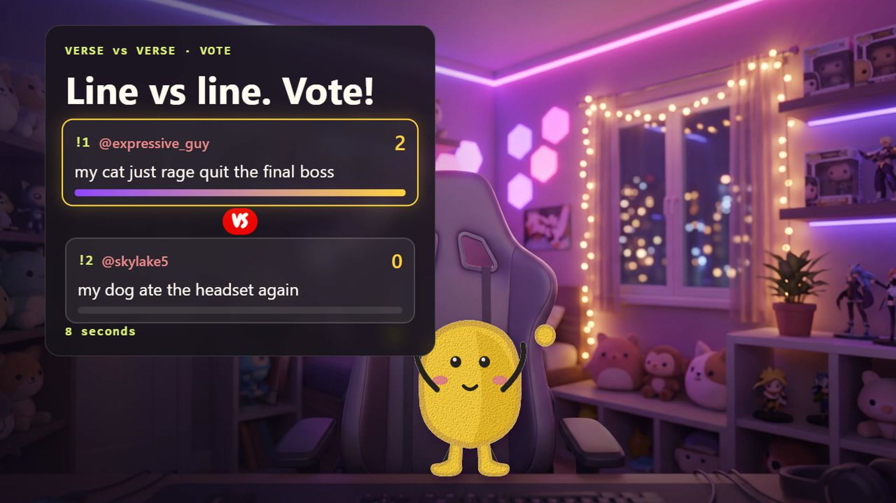
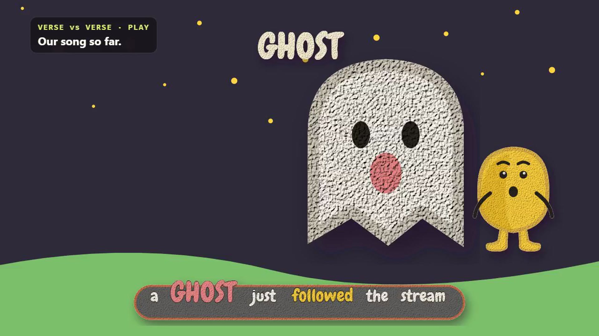

# Verse vs Verse

Verse vs Verse turns a Twitch chat into a live songwriting room. Viewers submit lyric lines, the lines compete for the chat's vote, and an AI band sings each winning line on stream within seconds. Each line is shown as an animated scene. When the song is finished, the channel gets a music video that credits every writer.

Built for the Codex x TwitchCon Hackathon with OpenAI Codex.





## Who it is for

- **Streamers** who want an interactive segment their chat builds together: Just Chatting, music streams, community nights, or a break between matches.
- **Communities** who want to make something that lasts. Every finished song keeps the names of the people who wrote it.

## How it is used

1. The streamer adds one browser source to OBS and presses **Start** on the dashboard.
2. Chat writes. Each viewer submits one line per round with `!line <lyric>`.
3. Lines compete. An AI judge shortlists the strongest lines, and chat votes with `!1` to `!4`. The options and live counts appear on stream and in chat.
4. The winner is sung. The winning line is recorded by the AI band and plays on stream with its own animated scene and karaoke lyrics.
5. The song grows. Each round adds a line, and the full song plays again.
6. The song is released with a title, writer credits, a share page and an optional music video.

Chat commands: `!line`, `!1` to `!4`, `!song`, `!queue`, `!help`, and `!skip` for the broadcaster and moderators.

## Features

- **Real Twitch integration.** Chat is read through EventSub, the bot replies through the Helix Chat API, the overlay runs as an OBS browser source, and a built-in broadcaster can go live without OBS.
- **The chat's exact words.** Lyrics are sung word for word, and every clip is checked against the submitted lines.
- **Scenes that follow the lyrics.** In "crown me king" the character wears the crown. In "dancing on the moon" it dances on the moon. It holds the controller, reacts to the mood of the line, and lip-syncs only on sung words. Shots crossfade on the beat.
- **Music videos.** The finished song is rendered to MP4 with synced lyrics, intro and credits.
- **Moderation.** Every line is screened for length, links, spam and content before it can appear on stream.
- **Pluggable models.** Music, speech-to-text and voice run through [Pascal](https://pascalai.co), a voice AI platform that exposes many models through one API. Changing the music model is a single setting.
- **Pluggable art styles.** The visual style lives in `skills/clay-scenes/` (style guide, palette and a library of 40 SVG props). The same renderer drives the live overlay and the video export.

## Built with OpenAI Codex

OpenAI Codex built Verse vs Verse in a single thread, one stage at a time:

1. **Foundation:** Twitch OAuth, EventSub over WebSocket, the round engine, the OBS overlay and the streamer dashboard.
2. **Model adapters:** an OpenAI-compatible judge that ranks lines and writes song titles, content moderation, and the Pascal adapter for music, speech-to-text and voice.
3. **Scene engine:** an LLM plans each line as a scene, and an SVG renderer draws every frame. Videos are exported through headless Chrome and ffmpeg, with a share page for each song.
4. **Timing and export:** line timing from the music model, streamed export, and scene validation.
5. **Animation:** time-driven motion, bundled fonts, karaoke lyrics and interludes.
6. **Presentation:** lyric layout with word highlighting, the character design, and intro and credits cards.
7. **Live operation:** retries, release recovery, lyric fidelity scoring, loop mode, chat commands and live timers.
8. **Art library:** 40 SVG props with anchor points and motions, character poses, and beat-driven props and camera.

The commit history follows these stages.

## Architecture

| Area | Files |
|---|---|
| Server, OAuth, API | `src/server.ts` |
| Round engine | `src/round-engine.ts` |
| Twitch EventSub and chat | `src/twitch.ts` |
| Model adapters (OpenAI, Pascal) | `src/adapters/` |
| Lyric alignment | `src/lyric-sync.ts` |
| Music video export | `src/video-export.ts` |
| Scene renderer | `public/scene-renderer.js` |
| Overlay and dashboard | `public/` |
| Art style and props | `skills/clay-scenes/` |
| Broadcast and rehearsal tools | `scripts/` |

## Setup

Requirements: Node.js 22, ffmpeg, and Google Chrome (for video export and broadcasting).

```powershell
npm install
Copy-Item .env.example .env
npm run dev
```

Open http://localhost:3000/dashboard.

Without API keys, every adapter runs a local mock, so the full flow can be tried offline with **Simulate chat** on the dashboard.

### Keys

Set these in `.env`:

| Variable | Purpose |
|---|---|
| `LLM_API_KEY` | OpenAI-compatible model for the judge, titles and scenes |
| `OPENAI_API_KEY` | Content moderation |
| `PASCAL_API_KEY` | Music, speech-to-text and voice |
| `TWITCH_CLIENT_ID`, `TWITCH_CLIENT_SECRET` | Twitch application credentials |
| `TWITCH_CHANNEL_LOGIN` | The channel to run on |

Create a Twitch application at https://dev.twitch.tv/console with the redirect URL `http://localhost:3000/auth/callback`, then open `/auth/login` and sign in as the broadcaster.

### Options

| Variable | Default | Effect |
|---|---|---|
| `WRITE_SECONDS`, `VOTE_SECONDS`, `ROUNDS_PER_SONG` | 45, 30, 4 | Round timing (also editable on the dashboard) |
| `RELEASE_MODE` | `clip` | `full` renders a longer final version of the song |
| `MUSIC_VIDEO` | `off` | `on` renders an MP4 music video after each song |
| `PASCAL_MUSIC_MODEL` | `lyria-3-clip-preview` | Music model used for each round |

## Going live

- **With OBS:** add a Browser Source pointing to `http://localhost:3000/overlay` at 1920x1080. The overlay is transparent.
- **Without OBS:** `npm run broadcast` streams the overlay to the connected channel and saves a local recording.
- **Rehearsal:** `npm run rehearse -- demo-scripts/demo-song.json` runs a planned song through Twitch chat, which is useful for testing a setup before going live.

## Tests

```powershell
npm test
npm run build
```

## Credits

- **[OpenAI Codex](https://openai.com/codex/)** built the application.
- **[Pascal](https://pascalai.co)** is a voice AI platform built by the author of Verse vs Verse. It provides music generation, speech-to-text and text-to-speech through a single API, and powers every song in this project.
- **[Twitch](https://dev.twitch.tv)** EventSub and Helix APIs connect the game to live chat.
- **[OpenAI](https://platform.openai.com)** models judge lines, write song titles, plan scenes and moderate chat.
- **[Chewy](https://fonts.google.com/specimen/Chewy)** font by Sideshow, under the Apache License 2.0.

## License

MIT. See [LICENSE](LICENSE).
