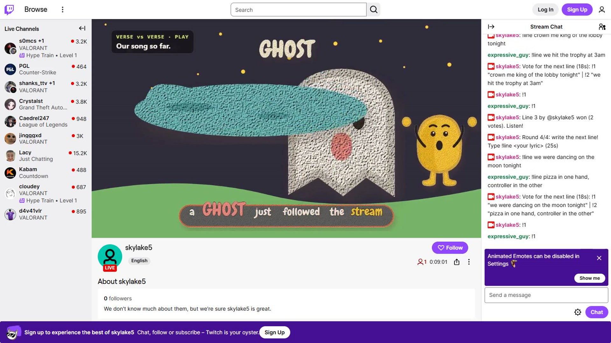

# Verse vs Verse

Verse vs Verse turns a Twitch chat into a live songwriting room. Viewers submit lyric lines, the lines compete for the chat's vote, and an AI band sings each winning line on stream. Each line is shown as an animated scene. When the song is finished, the channel gets a music video that credits every writer.

Built for the Codex x TwitchCon Hackathon with OpenAI Codex.

**Demo video:** [youtu.be/LquaIDX2JBo](https://youtu.be/LquaIDX2JBo)




## Who it is for

- **Streamers** who want an interactive segment their chat builds together: Just Chatting, music streams, community nights, or a break between matches.
- **Communities** who want to make something that lasts. Every finished song keeps the names of the people who wrote it.

## How it is used

1. The streamer adds one browser source to OBS and presses **Start** on the dashboard.
2. Chat writes. Each viewer submits one line per round with `!line <lyric>`.
3. Lines compete. An AI judge shortlists the strongest lines, and chat votes with `!1` to `!4`. The options and live counts appear on stream and in chat.
4. The winner is sung. The winning line is recorded by the AI band and plays on stream with its own animated scene and karaoke lyrics.
5. The song grows. Each round adds a line, and the full song plays again.
6. The song is released with a title, writer credits, a share page and an optional music video.

Chat commands: `!line`, `!1` to `!4`, `!song`, `!queue`, `!help`, and `!skip` for the broadcaster and moderators.

## Features

- **Real Twitch integration.** Chat is read through EventSub, the bot replies through the Helix Chat API, the overlay runs as an OBS browser source, and a built-in broadcaster can go live without OBS.
- **The chat's exact words.** Lyrics are sung word for word, and every clip is checked against the submitted lines.
- **Scenes that follow the lyrics.** In "crown me king" the character wears the crown. In "dancing on the moon" it dances on the moon. It holds the controller, reacts to the mood of the line, and lip-syncs only on sung words. Shots crossfade on the beat.
- **Music videos.** The finished song is rendered to MP4 with synced lyrics, intro and credits.
- **Moderation.** Every line is screened for length, links, spam and content before it can appear on stream.
- **Pluggable models.** Music, speech-to-text and voice run through [Pascal](https://pascalai.co), a voice AI platform that exposes many models through one API. Changing the music model is a single setting.
- **Pluggable art styles.** The visual style lives in `skills/clay-scenes/` (style guide, palette and a library of 40 SVG props). The same renderer drives the live overlay and the video export.

## Built with OpenAI Codex

OpenAI Codex built Verse vs Verse in a single thread, one stage at a time:

1. **Foundation:** Twitch OAuth, EventSub over WebSocket, the round engine, the OBS overlay and the streamer dashboard.
2. **Model adapters:** an OpenAI-compatible judge that ranks lines and writes song titles, content moderation, and the Pascal adapter for music, speech-to-text and voice.
3. **Scene engine:** an LLM plans each line as a scene, and an SVG renderer draws every frame. Videos are exported through headless Chrome and ffmpeg, with a share page for each song.
4. **Timing and export:** line timing from the music model, streamed export, and scene validation.
5. **Animation:** time-driven motion, bundled fonts, karaoke lyrics and interludes.
6. **Presentation:** lyric layout with word highlighting, the character design, and intro and credits cards.
7. **Live operation:** retries, release recovery, lyric fidelity scoring, loop mode, chat commands and live timers.
8. **Art library:** 40 SVG props with anchor points and motions, character poses, and beat-driven props and camera.

The commit history follows these stages.

## Architecture

| Area | Files |
|---|---|
| Server, OAuth, API | `src/server.ts` |
| Round engine | `src/round-engine.ts` |
| Twitch EventSub and chat | `src/twitch.ts` |
| Model adapters (OpenAI, Pascal) | `src/adapters/` |
| Lyric alignment | `src/lyric-sync.ts` |
| Music video export | `src/video-export.ts` |
| Scene renderer | `public/scene-renderer.js` |
| Overlay and dashboard | `public/` |
| Art style and props | `skills/clay-scenes/` |
| Broadcast and rehearsal tools | `scripts/` |

## Quick start

Requirements: Node.js 22, ffmpeg, and Google Chrome (for video export and broadcasting).

```powershell
npm install
Copy-Item .env.example .env
npm run dev
```

Open http://localhost:3000/dashboard.

Each adapter falls back to a local mock when its key is not set, so the full flow can be tried offline with **Simulate chat** on the dashboard. Adding keys switches the matching adapter to the real model.

### Keys

Set these in `.env`:

| Variable | Purpose |
|---|---|
| `PASCAL_API_KEY` | Music generation, speech-to-text (lyric timing) and voice |
| `LLM_API_KEY` | OpenAI-compatible model for the line judge, song titles and scene planning |
| `OPENAI_API_KEY` | Content moderation |
| `TWITCH_CLIENT_ID`, `TWITCH_CLIENT_SECRET` | Twitch application credentials |
| `TWITCH_CHANNEL_LOGIN` | The channel to run on |

**For judges:** a Pascal API key is included in the Devpost testing instructions. Set it as `PASCAL_API_KEY` to generate real songs. Add an OpenAI key as `LLM_API_KEY` and `OPENAI_API_KEY` for AI judging, scene planning and moderation.

### Models

The defaults below are the recommended models for each role.

| Variable | Default | Role |
|---|---|---|
| `PASCAL_MUSIC_MODEL` | `lyria-3-clip-preview` | Sings each winning line |
| `PASCAL_RELEASE_MODEL` | `lyria-3-pro-preview` | Full-length final song, used only when `RELEASE_MODE=full` |
| `PASCAL_ASR_MODEL` | `qwen3-asr-1.7b` | Speech-to-text that times each sung word for the karaoke lyrics and lip sync |
| `PASCAL_TTS_MODEL` | empty (off) | Optional spoken announcement when a song is released. Set to any Pascal text-to-speech model ID |
| `LLM_MODEL` | `gpt-6-luna` | Shortlists the strongest lines and writes song titles |
| `SCENE_MODEL` | `gpt-6.1-sol` | Scene planning: turns each line into a scene (props, character pose, motion and camera) that the SVG renderer animates |
| `LLM_BASE_URL` | `https://api.openai.com/v1` | Any OpenAI-compatible endpoint can be used for the two models above |
| `MODERATION_PROVIDER` | `openai` | OpenAI moderation endpoint. `none` keeps only the local filters |

The scene model plans every animation, and the art style it draws from lives in `skills/clay-scenes/`. No separate agent setup is needed: with `LLM_API_KEY` set, each winning line is planned and animated automatically.

Create a Twitch application at https://dev.twitch.tv/console with the redirect URL `http://localhost:3000/auth/callback`, then open `/auth/login` and sign in as the broadcaster.

### Options

| Variable | Default | Effect |
|---|---|---|
| `WRITE_SECONDS`, `VOTE_SECONDS`, `ROUNDS_PER_SONG` | 45, 30, 4 | Round timing (also editable on the dashboard) |
| `RELEASE_MODE` | `clip` | `full` renders a longer final version of the song |
| `MUSIC_VIDEO` | `off` | Optional. `on` renders an MP4 music video after each song |
| `MAX_SONGS_PER_HOUR` | 3 | Limits how many songs are generated per hour |

## Running on a live Twitch channel

Verse vs Verse runs next to the streamer's broadcasting software, the same way most stream overlays and chat bots do. Chat events arrive through Twitch EventSub over WebSocket, so no public webhook URL is needed.

### 1. Register a Twitch application

1. Open the [Twitch Developer Console](https://dev.twitch.tv/console/apps) and choose **Register Your Application**.
2. Set the OAuth Redirect URL to the address the app runs on, for example `http://localhost:3000/auth/callback`.
3. Choose the **Confidential** client type, then copy the Client ID and generate a Client Secret.

### 2. Configure the channel

Set these values in `.env`:

```
TWITCH_CLIENT_ID=your-client-id
TWITCH_CLIENT_SECRET=your-client-secret
TWITCH_REDIRECT_URI=http://localhost:3000/auth/callback
TWITCH_CHANNEL_LOGIN=your_channel
MAX_SONGS_PER_HOUR=3
```

Add the API keys from the table above, then set `MUSIC_VIDEO=on` if each song should produce a music video.

### 3. Start the app and connect the channel

```powershell
npm start
```

Open `/auth/login` and sign in as the broadcaster. The app requests these scopes: `user:read:chat` and `user:write:chat` (to read and reply in chat), `channel:read:redemptions`, `moderator:read:followers`, and `channel:read:stream_key` (to go live without OBS). Tokens are stored in the local SQLite database and refreshed automatically.

### 4. Add the overlay to the stream

- **With OBS or Streamlabs:** add a Browser Source at 1920x1080 pointing to `http://localhost:3000/overlay`. The overlay is transparent and sits on top of the existing scene. Use `/overlay?stream=1` for the complete stream layout with the room backdrop and on-camera streamer.
- **Without OBS:** `npm run broadcast` reads the stream key through the Twitch API, streams the overlay straight to the channel, and saves a local recording.

### 5. Run a song

Go live, open `/dashboard`, and start a song. Viewers join with `!line <lyric>` during the write phase and `!1` to `!4` during the vote. The bot posts the instructions in chat each round, and `!help` repeats them.

To test a setup before going live, `npm run rehearse -- demo-scripts/demo-song.json` plays a planned song through Twitch chat.

### Hosting on a server

To run the app on a server instead of the streamer's PC:

1. Serve it over HTTPS behind a reverse proxy such as Caddy or nginx.
2. Set `TWITCH_REDIRECT_URI` to `https://your-domain/auth/callback`, and add the same URL in the Twitch Developer Console.
3. Protect `/dashboard` and `/auth` at the proxy, for example with basic authentication, because the dashboard controls the stream.
4. Point the OBS Browser Source to `https://your-domain/overlay`.

## Tests

```powershell
npm test
npm run build
```

## Credits

- **[OpenAI Codex](https://openai.com/codex/)** built the application.
- **[Pascal](https://pascalai.co)** is a voice AI platform built by the author of Verse vs Verse. It provides music generation, speech-to-text and text-to-speech through a single API, and powers every song in this project.
- **[Twitch](https://dev.twitch.tv)** EventSub and Helix APIs connect the game to live chat.
- **[OpenAI](https://platform.openai.com)** models judge lines, write song titles, plan scenes and moderate chat.
- **[Chewy](https://fonts.google.com/specimen/Chewy)** font by Sideshow, under the Apache License 2.0.

## License

MIT. See [LICENSE](LICENSE).
