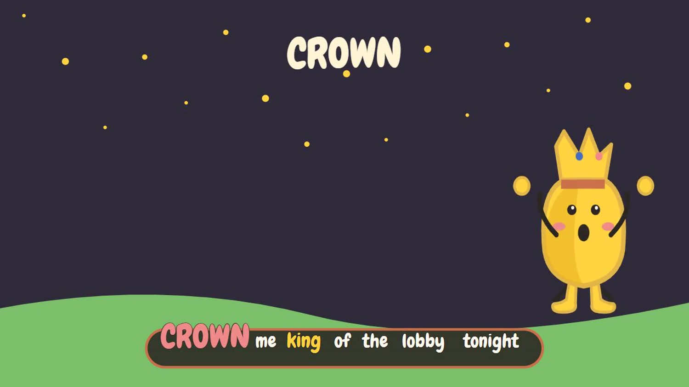

# Verse vs Verse

**Twitch chat writes a song, live.** Viewers type lyric lines, they battle head to head for chat's vote, and the winning line is sung by an AI band within seconds. Every round adds a line, the whole song plays on stream as an animated music video, and every writer is credited.

Built for the Codex x TwitchCon Hackathon with **OpenAI Codex**.

- Demo video: _(YouTube link)_
- Runs on real Twitch: EventSub chat in, Helix chat out, an OBS browser-source overlay, and a built-in "go live" broadcaster that streams without OBS.



## How a song works

| Phase | On stream | In chat |
|---|---|---|
| WRITE | "Drop your line." Every new line appears with its writer | `!line <your lyric>` |
| VOTE | An AI judge shortlists the best lines and they battle for chat's vote, with live counts. The bot posts the options in chat | `!1` `!2` `!3` `!4` |
| PRODUCE (~12 s) | The winning line and its writer while the AI band records it | |
| PLAY | The song so far, sung word for word, with an animated scene for every line | |
| RELEASE | The finished song with its title and writer credits; an optional music video and share page | `!song` |

Also: `!help`, `!queue`, and `!skip` (broadcaster or mod). Every line is checked (length, links, spam, OpenAI moderation) before it reaches the stream.

## What OpenAI Codex built

Codex built this project end to end, one stage at a time, in a single long thread:

1. **Foundation:** Twitch OAuth, EventSub over WebSocket, the round engine (write, vote, produce, play, release), the OBS overlay and the streamer dashboard.
2. **Real model adapters:** an OpenAI-compatible judge that ranks lines and writes song titles, moderation, and the Pascal adapter for music and speech.
3. **The scene engine:** an LLM plans each line as a scene (keyword, mood, character pose, props), and a pure SVG renderer draws it, with MP4 export through headless Chrome and ffmpeg and a share page per song.
4. **Timing and export hardening:** lyric timing from the model's line times, streamed export with timeouts and cleanup, scene repair.
5. **Animation:** line-keyed scenes, time-driven motion, bundled fonts, karaoke lyrics, interludes.
6. **Polish:** a font check before capture, the lyrics layout with word highlighting, the character's legs, intro and credits cards.
7. **Reliability:** it never fakes a song (no placeholder audio is ever saved), retries with backoff, release retry, a sung-fidelity score, loop mode, `!queue`/`!help`, and live timers.
8. **The prop library and a performing character:** 40 hand-built SVG props with anchors and motions, poses, a dance on the beat, and beat-driven props and camera.

The git history follows these stages.

## Design

- **Chat's exact words.** Lyrics go to the music model as plain lines with a strict prompt. With song-section tags the model invented 40–80% of a song; with the strict prompt it invented 0 lines in 10 test renders. Every clip gets a fidelity score.
- **Scenes follow the words.** The character wears the crown in "crown me king", stands on the moon in "dancing on the moon", holds the controller, and changes expression with the lyric. Its mouth only moves on sung words, and shots crossfade. The same renderer drives the live overlay and the video export, and the art style lives in a separate skill folder (`skills/clay-scenes/`), so new styles can be added.
- **Lyric sync.** `src/lyric-sync.ts` aligns chat's lines to word-level timestamps and finds every repeat.
- **One model API.** Music, speech-to-text and voice all go through [Pascal](https://pascalai.co), a voice AI platform built by the author of this project. It puts many models behind one API, so the music model can be swapped with one setting (`PASCAL_MUSIC_MODEL`) and no code change.

## Run it

Requirements: Node.js 22, ffmpeg, Chrome (for video export and the broadcaster).

```powershell
npm install
Copy-Item .env.example .env   # add keys, see below
npm run dev
```

Open http://localhost:3000/dashboard. Without keys every adapter runs a local mock, so the whole flow works offline (**Simulate chat** on the dashboard).

Keys in `.env`:
- `LLM_API_KEY` (any OpenAI-compatible endpoint) for the judge, titles and scenes; `OPENAI_API_KEY` for moderation.
- `PASCAL_API_KEY` for music and speech-to-text.
- `TWITCH_CLIENT_ID`, `TWITCH_CLIENT_SECRET`, `TWITCH_CHANNEL_LOGIN`. Create a Twitch app with the redirect URL `http://localhost:3000/auth/callback`, then open `/auth/login` as the broadcaster.

Options: `RELEASE_MODE=full` renders a longer final song (the default `clip` releases instantly from the last round). `MUSIC_VIDEO=on` renders an MP4 music video after each song.

## On stream

- **OBS:** add a Browser Source with `http://localhost:3000/overlay` at 1920x1080. It's transparent, so it sits over your game or camera.
- **Without OBS:** `npm run broadcast` renders the overlay and streams it to the connected channel (the stream key is read through the Twitch API), and saves a local copy.
- **Rehearsal and load testing:** extra chat accounts can be added at `/auth/login?actor=1`, and `npm run rehearse -- demo-scripts/demo-song.json` plays a planned song through real Twitch chat.

## Tests

```powershell
npm test     # round engine, lyric sync, timing, moderation fallback, renderer, export
npm run build
```
